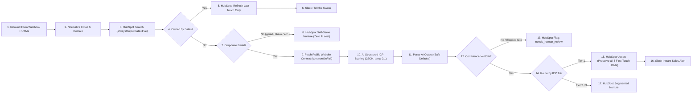

# AI Inbound Lead Enrichment, ICP Scoring & HubSpot Routing

A visual **n8n + HubSpot + LLM** workflow that turns raw inbound form submissions into clean, deduplicated, UTM-attributed, ICP-scored CRM records and instant Tier 1 Sales alerts, with explicit guardrails for contacts Sales already owns, free emails, low AI confidence, and workflow failures.

**[Explore the interactive workflow walkthrough](https://errer441122.github.io/ai-inbound-lead-router/)** · **[Download n8n blueprint (`workflows/ai-inbound-lead-router.n8n.json`)](workflows/ai-inbound-lead-router.n8n.json)** · **[Error Notifier (`workflows/error-notifier.n8n.json`)](workflows/error-notifier.n8n.json)**

> **What is real and what is a test:** the workflow is an importable n8n blueprint for HubSpot Free CRM (Private App), OpenAI (`gpt-4o-mini`) or Google Gemini (`gemini-2.5-flash`), and Slack (`#inbound-tier1-leads`, `#martech-alerts`). The 30 test cases in `data/real-companies-benchmark.csv` pair real public company domains with **invented** inbound messages and list the route each case should take; they have not been run end to end yet. The leads on the walkthrough page are examples. No private customer data is used.

---

**Tested in n8n 2.48.7.** In 12 synthetic routing scenarios, the corrected
workflow produced all 12 expected destinations. A failed site lookup, a missing
or unknown tier, and a confidence score outside 0–100 previously let four
contacts through. The parser now sends all four to human review. The run used
a manual trigger and test doubles for the website, the model, HubSpot and
Slack. [See the cases and observed routes](docs/routing-verification.md).

## The Business Problem

In most B2B and e-commerce growth teams, inbound forms dump unverified leads straight into the CRM:
- **Slow speed-to-lead:** high-fit prospects sit in the same generic inbox as personal `gmail.com` inquiries and students.
- **Dirty CRM & broken attribution:** repeat form fills overwrite original `First Touch UTM` values, or re-route a lead a rep is already working.
- **Unsafe AI automation:** naive LLM workflows hallucinate company facts or auto-send unreviewed emails when a company website is unreachable.

---

## System Architecture (Main Workflow + Standalone Error Workflow)

*Global safety net:* link [`workflows/error-notifier.n8n.json`](workflows/error-notifier.n8n.json) under **Settings → Error Workflow** in n8n so a failed HubSpot or Slack call (for example a 429) posts immediately to `#martech-alerts`.

---

## Key Operational Guardrails

| Risk | How This Workflow Handles It | Documentation |
| --- | --- | --- |
| **Re-routing a lead Sales is already working** | `Guard: Owned by Sales?` reads `hubspot_owner_id` before any write. If the contact has an owner, the workflow only refreshes the last-touch UTMs and tells the owner in Slack: no AI call, `icp_tier` and `routing_status` untouched | [`docs/field-ownership-matrix.md`](docs/field-ownership-matrix.md) |
| **Overwriting First-Touch UTMs** | `first_touch_utm_*` is **fill-if-blank only** on every write node, `last_touch_utm_*` always refreshes, `lifecyclestage` and the owner are never written | [`docs/field-ownership-matrix.md`](docs/field-ownership-matrix.md) |
| **Wasted AI credits on personal emails** | Pre-AI `IF` gate sends `gmail.com`, `yahoo.com`, `libero.it`, `outlook.com`, `icloud.com` and similar straight to self-serve nurture | [`workflows/ai-inbound-lead-router.n8n.json`](workflows/ai-inbound-lead-router.n8n.json) |
| **AI hallucinations or blocked websites** | Strict JSON output contract (`temperature = 0.1`), `continueOnFail = true` on the website fetch and the AI call, and a hard **`confidence_score >= 80` gate** routing uncertain cases to `needs_human_review` | [`prompts/icp-scoring-prompt.md`](prompts/icp-scoring-prompt.md) |
| **Unreviewed AI emails sent to prospects** | **Human-in-the-loop by design:** the AI opener is posted only inside Slack for a rep to verify before sending | [`docs/sop-inbound-lead-routing.md`](docs/sop-inbound-lead-routing.md) |

---

## 30 Test Cases (25 Real Company Domains + 5 Edge Cases)

Test matrix: [`data/real-companies-benchmark.csv`](data/real-companies-benchmark.csv)

- **25 real European D2C & B2B SaaS public domains** (*Velasca, Cortilia, Tannico, Gymshark, Huel, Factorial, Qonto, Brevo, Typeform, Holded, Pipedrive, Fatture in Cloud, Pennylane, Scalapay, Casavo, Satispay, Bending Spoons, Subito, Vinted, Too Good To Go, Klarna, N26, Revolut, Wise, Zalando*). The workflow would fetch their real homepages; the inbound messages are **invented** test inputs, not enquiries from these companies.
- **3 personal free-email cases** (`gmail.com`, `libero.it`, `outlook.com`) that should never reach the AI.
- **2 failure / low-confidence cases** that should land in `needs_human_review`.
- **Status:** each row lists `expected_route` and `expected_icp_tier`. The set has **not been run end to end yet**. To run it, POST each row to the webhook and compare HubSpot's `routing_status` and `icp_tier` with the expected columns.
- **Estimated API unit cost:** ~€0.001–€0.002 per corporate lead (~€1–€2 per 1,000 leads on `gpt-4o-mini` / `gemini-2.5-flash` list prices).

---

## Quick Import & Walkthrough

1. Open n8n (local via `npx n8n` or cloud) → **Workflows → Import from File** → import [`workflows/ai-inbound-lead-router.n8n.json`](workflows/ai-inbound-lead-router.n8n.json) and [`workflows/error-notifier.n8n.json`](workflows/error-notifier.n8n.json).
2. In the main workflow, open **Settings → Error Workflow** and select `Error Notifier — Inbound Lead Router`.
3. Connect a free **HubSpot** Private App (`crm.objects.contacts.read` & `.write`), an LLM API key (`gpt-4o-mini` or `gemini-2.5-flash`), and Slack following [`docs/sop-inbound-lead-routing.md`](docs/sop-inbound-lead-routing.md).
4. Send test POST payloads to the Webhook URL and inspect the Contact record in HubSpot + alert in Slack.

## Repository Structure

| Path | Content |
| --- | --- |
| `workflows/ai-inbound-lead-router.n8n.json` | Importable n8n workflow (owner gate, free-email filter, AI confidence gate, first-touch UTM lock) |
| `workflows/error-notifier.n8n.json` | Standalone 2-node Error Workflow routing execution failures to `#martech-alerts` |
| `prompts/icp-scoring-prompt.md` | ICP rubric, system prompt, JSON output contract & hallucination guardrails |
| `docs/field-ownership-matrix.md` | CRM overwrite & First-Touch / Last-Touch UTM governance rules |
| `docs/sop-inbound-lead-routing.md` | 10-minute setup & daily/monthly Operations SOP |
| `data/real-companies-benchmark.csv` | 30 test cases: real company domains, invented messages, expected routes |
| `docs/index.html` | Interactive visual workflow explorer (GitHub Pages) |

## License

MIT. See [LICENSE](LICENSE).
