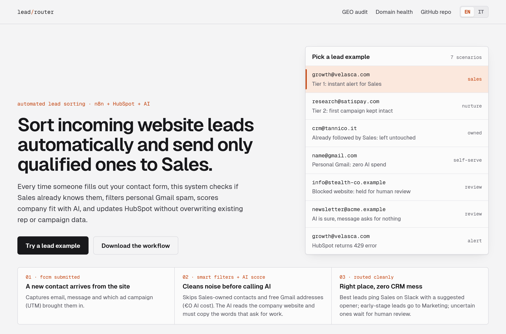
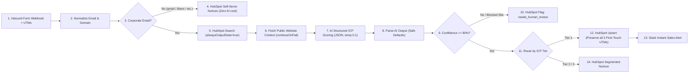

# AI Inbound Lead Enrichment, ICP Scoring & HubSpot Routing

A visual **n8n + HubSpot + LLM** workflow system that turns raw inbound form submissions into clean, deduplicated, UTM-attributed, ICP-scored CRM records and instant Tier 1 Sales alerts — with explicit guardrails for free emails, field ownership, low AI confidence, and workflow failures.

**[Explore the interactive workflow walkthrough](https://errer441122.github.io/ai-inbound-lead-router/)** · **[Download n8n blueprint (`workflows/ai-inbound-lead-router.n8n.json`)](workflows/ai-inbound-lead-router.n8n.json)** · **[Error Notifier (`workflows/error-notifier.n8n.json`)](workflows/error-notifier.n8n.json)**

> **Live Testing & Scope:** Importable 14-node n8n blueprint + standalone 2-node Error Workflow validated against a 30-case European company rubric (`data/real-companies-benchmark.csv`). Configured for HubSpot Free CRM (Private App), OpenAI (`gpt-4o-mini`) or Google Gemini (`gemini-2.5-flash`), and Slack (`#inbound-tier1-leads`, `#martech-alerts`). All webhook test inputs are simulated form payloads (no private customer data).

---

## The Business Problem

In most B2B and e-commerce growth teams, inbound forms dump unverified leads straight into the CRM:
- **Slow speed-to-lead:** high-fit prospects sit in the same generic inbox as personal `gmail.com` inquiries and students.
- **Dirty CRM & broken attribution:** repeat form fills overwrite original `First Touch UTM` values or clobber Sales-owned deal/lifecycle fields.
- **Unsafe AI automation:** naive LLM workflows hallucinate company facts or auto-send unreviewed emails when a company website is unreachable.

---

## System Architecture (14-Node Main Workflow + Standalone Error Workflow)

*Global safety net:* link [`workflows/error-notifier.n8n.json`](workflows/error-notifier.n8n.json) under **Settings → Error Workflow** in n8n so any unhandled API timeout or 429 error posts immediately to `#martech-alerts`.

---

## Key Operational Guardrails

| Risk | How This Workflow Handles It | Documentation |
| --- | --- | --- |
| **Wasted enrichment/AI credits on personal emails** | Pre-AI `IF` gate blocks `gmail.com`, `yahoo.com`, `libero.it`, `outlook.com`, `icloud.com`, routing them straight to self-serve nurture | [`workflows/ai-inbound-lead-router.n8n.json`](workflows/ai-inbound-lead-router.n8n.json) |
| **Overwriting Sales data or First-Touch UTMs** | Contact lookup runs before every write; `first_touch_utm_*` is **fill-if-blank only**, `last_touch_utm_*` always refreshes, Sales-owned fields are never overwritten | [`docs/field-ownership-matrix.md`](docs/field-ownership-matrix.md) |
| **AI hallucinations or blocked websites** | Strict JSON output contract (`temperature = 0.1`), `continueOnFail = true` on website fetch, and a hard **`confidence_score >= 80` gate** routing uncertain cases to `needs_human_review` | [`prompts/icp-scoring-prompt.md`](prompts/icp-scoring-prompt.md) |
| **Unreviewed AI emails sent to prospects** | **Human-in-the-loop by design:** the AI opener is posted only inside Slack for a rep to verify before sending | [`docs/sop-inbound-lead-routing.md`](docs/sop-inbound-lead-routing.md) |

---

## 30-Case Routing Benchmark (25 Real European Companies + 5 Guardrail Edge Cases)

Full rubric test matrix: [`data/real-companies-benchmark.csv`](data/real-companies-benchmark.csv)

- **25 real European D2C & B2B SaaS public domains** (*Velasca, Cortilia, Tannico, Gymshark, Huel, Factorial, Qonto, Brevo, Typeform, Holded, Pipedrive, Fatture in Cloud, Pennylane, Scalapay, Casavo, Satispay, Bending Spoons, Subito, Vinted, Too Good To Go, Klarna, N26, Revolut, Wise, Zalando*) mapped to clear Tier 1 vs. Tier 2 routing rules based on real business model + inbound intent.
- **3 personal free-email hygiene cases** (`gmail.com`, `libero.it`, `outlook.com`) verifying zero AI spend on personal domains.
- **2 failure / low-confidence cases** verifying the `needs_human_review` fallback when a site blocks fetching or the message is ambiguous.
- **Estimated API unit cost:** ~€0.001–€0.002 per qualified corporate lead (~€1–€2 per 1,000 leads on `gpt-4o-mini` / `gemini-2.5-flash`).

---

## Quick Import & Walkthrough

1. Open n8n (local via `npx n8n` or cloud) → **Workflows → Import from File** → import [`workflows/ai-inbound-lead-router.n8n.json`](workflows/ai-inbound-lead-router.n8n.json) and [`workflows/error-notifier.n8n.json`](workflows/error-notifier.n8n.json).
2. In the main workflow, open **Settings → Error Workflow** and select `Error Notifier — Inbound Lead Router`.
3. Connect a free **HubSpot** Private App (`crm.objects.contacts.read` & `.write`), an LLM API key (`gpt-4o-mini` or `gemini-2.5-flash`), and Slack following [`docs/sop-inbound-lead-routing.md`](docs/sop-inbound-lead-routing.md).
4. Send test POST payloads to the Webhook URL and inspect the Contact record in HubSpot + alert in Slack.

## Repository Structure

| Path | Content |
| --- | --- |
| `workflows/ai-inbound-lead-router.n8n.json` | 1-click importable 14-node n8n workflow blueprint (`alwaysOutputData`, single safe AI parser, full 3-field First-Touch UTM lock) |
| `workflows/error-notifier.n8n.json` | Standalone 2-node Error Workflow routing execution failures to `#martech-alerts` |
| `prompts/icp-scoring-prompt.md` | ICP rubric, system prompt, JSON output contract & hallucination guardrails |
| `docs/field-ownership-matrix.md` | CRM overwrite & First-Touch / Last-Touch UTM governance rules |
| `docs/sop-inbound-lead-routing.md` | 10-minute setup & daily/monthly Operations SOP |
| `data/real-companies-benchmark.csv` | 30-case benchmark across 25 real European companies + 5 edge-case guardrails |
| `docs/index.html` | Interactive visual workflow explorer (GitHub Pages) |

## License

MIT. See [LICENSE](LICENSE).
