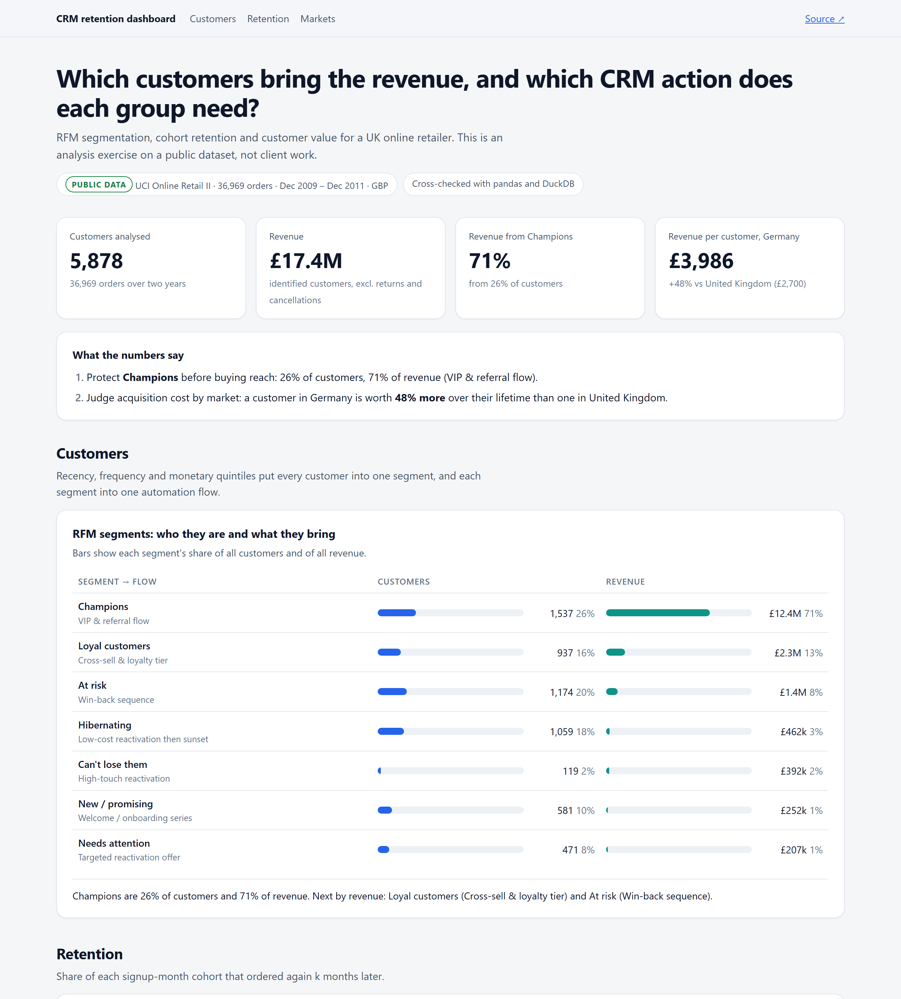

# CRM retention analysis: RFM, cohorts and customer value

An analysis exercise on a public dataset: 36,969 orders from 5,878 customers of
a UK online retailer (UCI *Online Retail II*, December 2009 to December 2011,
GBP). It is practice on public data, not client work.

**[Open the live dashboard](https://errer441122.github.io/digital-campaign-performance-dashboard/)**

[](https://errer441122.github.io/digital-campaign-performance-dashboard/)

## What the data says

- **Champions are 26% of customers and 71% of revenue.** Keeping them comes
  before buying new reach.
- **A customer in Germany has spent 48% more than one in the UK** (£3,986
  against £2,700 per customer), so a higher acquisition cost can still pay back
  there.
- **588 customers are "at risk"**: their last order was 91 to 180 days ago and
  they have spent £1.06M so far. That is the win-back list.
- **Between 9% and 35% of a cohort orders again the month after its first
  purchase.** The December 2009 cohort is the highest because it also contains
  customers acquired before the data starts.

Full tables: [RFM, cohorts and value by country](analysis/crm_retention.md) ·
[lifecycle stages](analysis/crm_lifecycle.md).

The lifecycle thresholds are the ones my
[lifecycle-automation-lab](https://github.com/errer441122/lifecycle-automation-lab)
uses to trigger a win-back flow in Klaviyo.

## What is in here

| Path | What it does |
| --- | --- |
| `src/prepare_real_data.py` | Downloads the UCI file (SHA256-pinned) and cleans it into `data/online_retail_orders.csv` |
| `src/crm_retention.py` | RFM segments, cohort retention, revenue per customer by country |
| `src/crm_lifecycle.py` | Lifecycle stages: New, Repeat, At risk, Dormant, Churned |
| `src/build_web_dashboard.py` | The live page, `docs/index.html` |
| `src/build_dashboard.py` | Excel workbook `dashboard/crm_dashboard.xlsx` and a static preview image |
| `notebooks/cross_check.ipynb` | Recomputes the headline numbers with pandas and DuckDB SQL; CI fails if they differ |

## Run it

```bash
python -m pip install -r requirements.txt
python src/validate_data.py
python src/crm_retention.py
python src/crm_lifecycle.py
python src/build_dashboard.py
python src/build_web_dashboard.py
python -m pytest -q
```

`python src/prepare_real_data.py` is only needed to rebuild the orders file
from the original UCI download.

## Data

Chen, D. (2019). *Online Retail II*. UCI Machine Learning Repository, CC BY 4.0.
Source, cleaning rules and checksums are in
[`data/REAL_DATA_PROVENANCE.md`](data/REAL_DATA_PROVENANCE.md).

One cleaning detail worth knowing: the two yearly sheets of the source file
overlap on 1 to 9 December 2010. Reading both counts 776 orders twice and
overstates revenue by 1.8%. The preparation script reads each invoice once and
a test fails if that window looks doubled again.

## Limits

- This is a public dataset that many people practise on. It has no advertising,
  web analytics or email data, so nothing here measures a campaign.
- "Customer value" is historical revenue per customer, not a forecast.
- The relationships are observational, not causal.

## What changed in November 2026

Earlier versions also had campaign reporting, attribution, an A/B test and a
budget model, all running on data I had simulated. I removed them: numbers I
generated myself cannot show how a campaign performs. The repository keeps its
original name so existing links keep working.

## How I built this

Built with AI coding assistants as a pair programmer: they drafted most of the
code and docs. My part: choosing the question and the data, defining the rules
and metrics, checking results against the source data and deciding what to
report.
